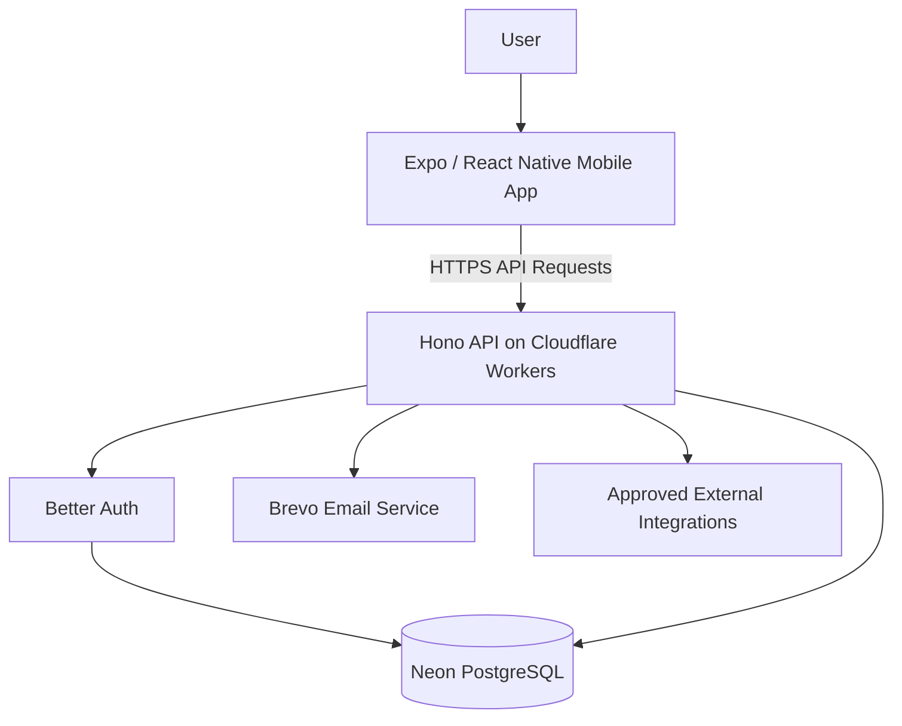

# VitaQera — System Architecture

## 1. Purpose

This document describes the high-level architecture of VitaQera, including the mobile application, backend API, authentication, database, and external services.

It provides a shared architectural reference for all project agents.

The actual repository implementation is the source of truth. Planned components must not be treated as implemented.

## 2. Architecture Overview

VitaQera follows a client-server architecture within a pnpm monorepo.

Main components:

- Mobile Application — user interface and client-side functionality.
- Backend API — business logic, authentication integration, and data access.
- Database — persistent application data.
- External Services — email delivery and other approved integrations.

## 3. High-Level Architecture

This diagram represents the intended architecture. Actual communication paths must be verified against the implementation.

## 4. Mobile Application

The mobile application is responsible for:

- Rendering screens and reusable UI components.
- Managing navigation through Expo Router.
- Managing client-side state through approved state-management patterns.
- Collecting and validating user input.
- Communicating with the backend API.
- Displaying fitness, nutrition, hydration, and progress information.
- Handling supported native device capabilities.

The mobile application must not directly access privileged database credentials or expose backend secrets.

## 5. Backend API

The backend API runs on Cloudflare Workers using Hono.

Its responsibilities include:

- Exposing API endpoints.
- Validating incoming requests.
- Enforcing authentication and authorization.
- Applying business rules.
- Accessing the database securely.
- Integrating approved external services.
- Handling errors consistently.
- Applying appropriate security and rate-limiting controls.

Sensitive business logic and privileged operations must remain server-side.

## 6. Authentication

Better Auth is the selected authentication solution.

The intended authentication flow includes:

- Email and password registration.
- Email and password sign-in.
- Email verification using OTP codes.
- Secure session management.
- Planned Google sign-in support for Android.

Authentication and authorization must be enforced by the backend, not merely by mobile UI restrictions.

The exact session, token, and verification implementation must be verified against the current code.

## 7. Database

Neon PostgreSQL is the selected managed database.

Drizzle ORM is used for schema definitions and database access.

The database is responsible for persistent information such as:

- User accounts and authentication records.
- User profiles.
- Fitness and workout information.
- Nutrition and food records.
- Hydration records.
- Weight and progress history.
- User preferences and notification settings.

These represent product data categories, not a declaration that all corresponding tables already exist.

Database access must follow approved ownership, isolation, and RLS policies.

## 8. External Services

### Brevo

Used for transactional email delivery, including authentication-related email messages.

### Future Integrations

Potential integrations include:

- Food and barcode data providers.
- Image storage services.
- Fitness and wearable platforms.
- AI-powered food recognition and nutrition assistance.

External integrations require evaluation and explicit approval before implementation.

## 9. Data Flow Principles

1. The mobile app sends requests to the backend API.
2. The backend validates and authorizes requests.
3. The backend applies business rules.
4. The backend accesses the database when necessary.
5. External services are called only through approved integration paths.
6. The backend returns appropriate responses to the mobile application.

Sensitive data must be protected in transit and at rest.

## 10. Security Boundaries

- Never expose database credentials in the mobile application.
- Never trust client-provided user IDs for authorization.
- Verify user identity on the server.
- Enforce ownership checks for user-specific records.
- Apply appropriate database access controls and RLS.
- Protect authentication endpoints against abuse.
- Validate external service responses.
- Avoid logging passwords, OTPs, tokens, or secrets.

## 11. Architectural Rules

- Follow approved architecture decisions.
- Keep business logic separate from presentation concerns.
- Avoid unnecessary dependencies and abstractions.
- Prefer maintainable and testable components.
- Preserve clear boundaries between mobile, backend, database, and integrations.
- Do not introduce new infrastructure without approval.
- Update this document when an approved architectural change occurs.

## 12. Current Implementation Status

This document describes the intended high-level architecture.

Agents must inspect the repository before reporting which components, integrations, or data flows are fully implemented.

Document significant architectural changes through Architecture Decision Records (ADRs).
